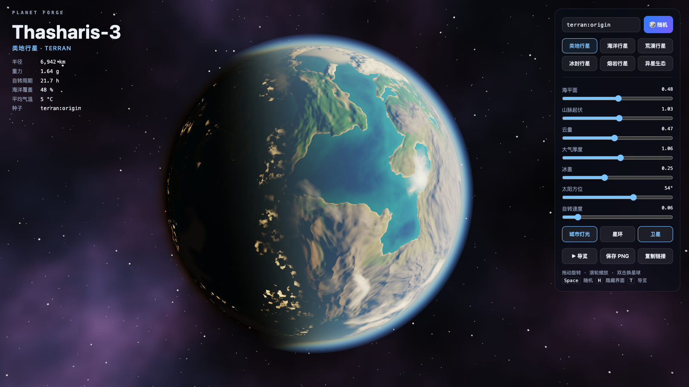
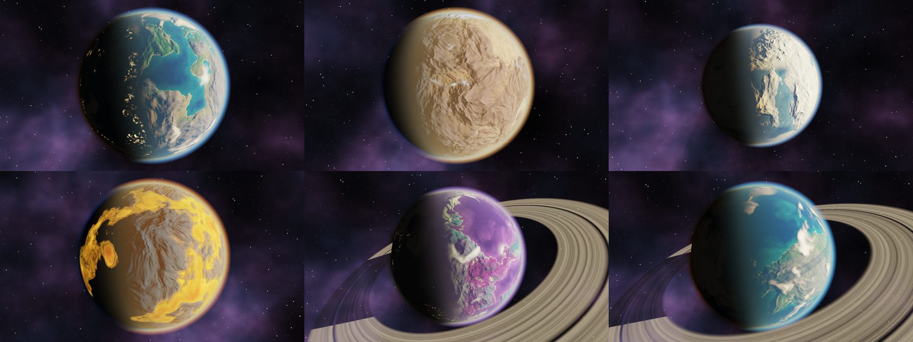

# Planet Forge

[English](README_EN.md) | 简体中文


一个片元着色器里的程序化星球。单个 HTML 文件，零依赖，双击打开。



## 它是什么

屏幕上的每个像素，都由同一段 GLSL 片元着色器现场算出来。没有贴图，没有模型，没有网格，没有任何第三方库，也不发任何网络请求。

输入一个种子，得到一颗星球。同一个种子永远得到同一颗星球，所以一个链接就能把你发现的星球分享给别人。



## 画面里有什么

- **地形**：三维分形噪声加域扭曲生成大陆轮廓，叠一层脊状噪声做山脉，再用有限差分求法线做光照起伏。

- **海洋**：按水深混合深浅两种颜色，带太阳镜面高光、菲涅尔反射和细碎波纹。

- **云层**：独立的球壳，噪声按纬度剪切成带状，随时间缓慢流动，并在地面投下阴影。

- **大气散射**：沿视线积分的单次散射，包含瑞利散射和米氏散射。蓝色的大气边缘和晨昏线上的橙红色都是算出来的，没有手调渐变。

- **夜面城市灯光**：只出现在低海拔、气候适宜的陆地上，被云层遮挡时会变暗。

- **星环与卫星**：星环有密度条纹和环缝，会被星球的影子切断，也会在星球表面投影。卫星绕轨运行，会进入星球的阴影。

- **六种星球配方**：类地、海洋、荒漠、冰封、熔岩、异星生态。切换时地形和配色平滑过渡。

## 运行

双击 `index.html`，或者：

```bash
open index.html
```

需要支持 WebGL2 的浏览器。目前只在 macOS 的 Chrome 上实测过，其他支持 WebGL2 的浏览器理论上可以运行，尚未验证。

## 操作

| 操作 | 效果 |
|---|---|
| 拖动 | 旋转视角 |
| 滚轮或双指捏合 | 缩放 |
| 双击或 `Space` | 随机一颗新星球 |
| `H` | 隐藏或显示界面 |
| `T` | 播放或停止自动导览 |
| 种子输入框回车 | 生成指定种子的星球 |

种子写成 `ice:任意文字` 这样的形式可以指定星球类型，可用前缀有 `terran`、`ocean`、`desert`、`ice`、`lava`、`alien`。

面板上的滑杆可以实时调整海平面、山脉起伏、云量、大气厚度、冰盖、太阳方位和自转速度。

链接参数：

| 参数 | 含义 |
|---|---|
| `#种子` | 打开时直接生成这颗星球，例如 `index.html#ice:halo` |
| `?tour` | 打开后自动播放导览 |
| `?clean` | 隐藏界面 |

## 性能

渲染分辨率会自适应：帧时间变长时自动降低内部分辨率，有余量时再升回来，左下角显示当前帧率和实际渲染分辨率。

在 Apple M1 Pro 上，交互运行时 2880×1800 的渲染分辨率下实测 37 到 60 帧，切换星球的过渡期间帧率最低。无头 Chrome 以 1920×1080 逐帧渲染并截图，PNG 格式约每秒 1.4 帧，JPEG 格式约每秒 15 帧。这两个数字的瓶颈在截图编码。

## 录制宣传视频

`scripts/capture.mjs` 通过 DevTools 协议驱动本机的无头 Chrome，同样不需要安装任何 npm 包。导览是确定性的，每一帧由脚本推进固定的时间步长，所以录出来的视频不会掉帧。

```bash
# 单张截图
node scripts/capture.mjs shot out.png "capture&clean&seed=ice:halo" 1920 1080 2

# 逐帧导出完整导览，再用 ffmpeg 合成
node scripts/capture.mjs video frames 1920 1080 30
ffmpeg -framerate 30 -i frames/f%05d.jpg -c:v libx264 -pix_fmt yuv420p -crf 18 tour.mp4
```

需要 Node.js 22 以上版本和本机安装的 Chrome。Chrome 路径可以用环境变量 `CHROME` 覆盖。

## 文件结构

| 文件 | 内容 |
|---|---|
| `index.html` | 全部内容：样式、着色器、交互逻辑，共 1029 行 |
| `scripts/capture.mjs` | 截图与视频逐帧导出脚本 |
| `promo/` | 宣传图与视频 |

## 已知限制

- 地形是球面上的法线扰动，不是真实位移，贴近地表时山脉没有轮廓起伏。

- 大气只算单次散射，积分步数固定为 10 步，极端的大气厚度下会出现轻微分层。

- 星球的物理参数，包括半径、重力、气温，是由种子生成的设定文字，不参与渲染计算。

## License

[MIT](LICENSE)
