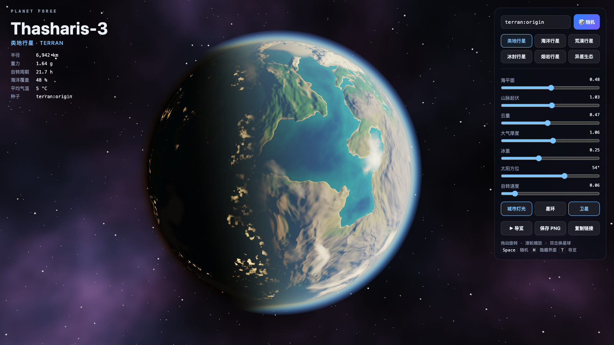
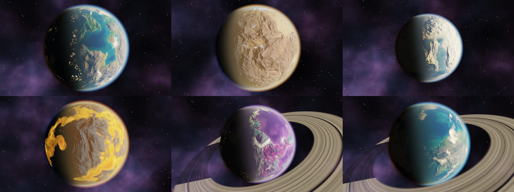

# Planet Forge

English | [简体中文](README.md)


Procedural planets in a single fragment shader. One HTML file, zero dependencies, opens with a double click.



## What it is

Every pixel on screen is computed on the spot by the same GLSL fragment shader. There are no textures, no models, no meshes, no third-party libraries, and no network requests.

A seed goes in, a planet comes out. The same seed always produces the same planet, so a link is enough to share one.



## What is rendered

- **Terrain**: 3D fractal noise with domain warping shapes the continents, ridged noise adds mountain ranges, and finite-difference normals give the relief its lighting.

- **Oceans**: colour blended by depth, with a sun glint, Fresnel reflection and small waves.

- **Clouds**: a separate shell. The noise is sheared along latitude into bands, drifts over time, and casts shadows on the ground.

- **Atmospheric scattering**: single scattering integrated along the view ray, with Rayleigh and Mie terms. The blue limb and the orange terminator are computed, not painted gradients.

- **City lights**: only on low, temperate land on the night side, dimmed where clouds cover them.

- **Rings and a moon**: the rings have density bands and a gap, are cut by the planet's shadow, and cast their own shadow on the surface. The moon orbits and passes into the planet's shadow.

- **Six recipes**: terran, ocean, desert, ice, lava and alien. Terrain and palette blend smoothly when switching.

## Run

Double-click `index.html`, or:

```bash
open index.html
```

A browser with WebGL2 is required. Recent versions of Chrome, Edge, Safari and Firefox all work.

## Controls

| Input | Effect |
|---|---|
| Drag | Orbit the camera |
| Wheel or pinch | Zoom |
| Double click or `Space` | A new random planet |
| `H` | Hide or show the UI |
| `T` | Start or stop the guided tour |
| Enter in the seed box | Generate the planet for that seed |

A seed written as `ice:anything` forces a planet type. The prefixes are `terran`, `ocean`, `desert`, `ice`, `lava` and `alien`.

The sliders adjust sea level, mountain relief, cloud cover, atmosphere thickness, ice caps, sun azimuth and spin speed in real time.

URL parameters:

| Parameter | Meaning |
|---|---|
| `#seed` | Generate this planet on load, for example `index.html#ice:halo` |
| `?tour` | Start the guided tour on load |
| `?clean` | Hide the UI |

## Performance

Render resolution adapts: the internal resolution drops when frames run long and recovers when there is headroom. The bottom-left corner shows the current frame rate and the actual render resolution.

On an Apple M1 Pro, headless Chrome renders and screenshots 1920×1080 frames at about 1.4 frames per second as PNG and about 15 as JPEG. Screenshot encoding is the bottleneck, so neither number describes the interactive frame rate.

## Recording the promo video

`scripts/capture.mjs` drives the locally installed headless Chrome over the DevTools protocol and needs no npm packages. The tour is deterministic and the script advances a fixed time step per frame, so the recording never drops frames.

```bash
# One screenshot
node scripts/capture.mjs shot out.png "capture&clean&seed=ice:halo" 1920 1080 2

# Export the full tour frame by frame, then encode with ffmpeg
node scripts/capture.mjs video frames 1920 1080 30
ffmpeg -framerate 30 -i frames/f%05d.jpg -c:v libx264 -pix_fmt yuv420p -crf 18 tour.mp4
```

Node.js 22 or later and a local Chrome are required. Set the `CHROME` environment variable to override the Chrome path.

## Layout

| File | Contents |
|---|---|
| `index.html` | Everything: styles, shader and interaction logic, 1028 lines |
| `scripts/capture.mjs` | Screenshot and frame-by-frame video export |
| `promo/` | Promo images and video |

## Known limitations

- Terrain is a normal perturbation on a sphere, not real displacement, so mountains have no silhouette up close.

- The atmosphere is single scattering with a fixed 10 integration steps, and shows slight banding at extreme thickness.

- The physical figures, including radius, gravity and temperature, are flavour text generated from the seed and take no part in rendering.

## License

[MIT](LICENSE)
